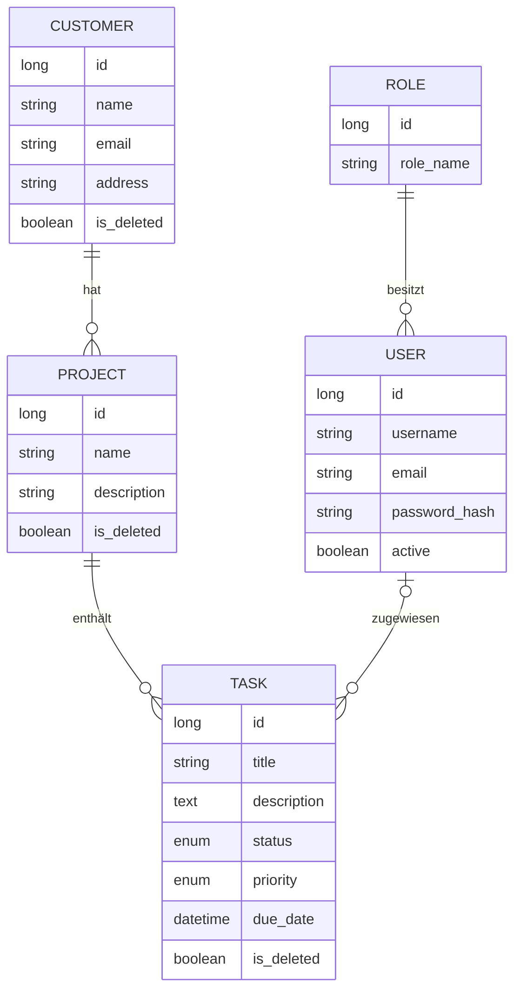

# TaskManager – IPA 2026

Internes Task-Management-Tool zur Verwaltung von **Kunden, Projekten und Aufgaben** mit
rollenbasierter Zugriffskontrolle (RBAC) und differenzierter Löschlogik (Soft- und Hard-Delete).
Entstanden als **Individuelle Praktische Arbeit (IPA)** zum Abschluss als
**Informatikerin EFZ Applikationsentwicklung**, umgesetzt als Einzelarbeit in **10 Arbeitstagen**.


---

## Inhalt

- [Über das Projekt](#über-das-projekt)
- [Funktionen](#funktionen)
- [Screenshots](#screenshots)
- [Technologien](#technologien)
- [Architektur](#architektur)
- [Datenmodell](#datenmodell)
- [Installation & Start](#installation--start)
- [Testbenutzer](#testbenutzer)
- [Tests](#tests)
- [Herausforderungen & Learnings](#herausforderungen--learnings)
- [Ausblick](#ausblick)
- [Kontakt](#kontakt)

---

## Über das Projekt

**Ausgangslage:** Die Pritz IT verwaltet ihre Aufgaben in JIRA. Für die Praktikantinnen und Praktikanten
sollte ein eigenes, internes Tool entstehen, das sie organisatorisch von den Mitarbeitenden trennt und
das sie selbst weiter ausbauen können.

**Lösung:** Der TaskManager bündelt Kunden, deren Projekte und die dazugehörigen Aufgaben in einer
zentralen Webapplikation. Aufgaben lassen sich Benutzern zuweisen, priorisieren und über ihren Status
verfolgen. Administratoren verwalten zusätzlich die Benutzerkonten und dürfen Daten endgültig löschen.

| | |
|---|---|
| **Art** | Individuelle Praktische Arbeit (IPA), Einzelarbeit |
| **Dauer** | 10 Arbeitstage |
| **Ausbildung** | Informatikerin EFZ Applikationsentwicklung, Bénédict-Schule Zürich |
| **Durchführung** | Pritz IT GmbH, Kanton Zürich |
| **Projektmethode** | IPERKA |
| **Jahr** | 2026 |

## Funktionen

- **Login & Rollenkonzept**: Anmeldung mit Spring Security, Passwörter mit BCrypt gehasht,
  Fehlermeldung bei ungültigem Login; Zugriffsschutz auf zwei Ebenen: pro Ansicht über `@RolesAllowed`
  und pro Service-Methode über `@PreAuthorize`
- **Kundenverwaltung**: Kunden erfassen, bearbeiten, suchen und archivieren
- **Projektverwaltung**: Projekte einem Kunden zuordnen, mit Detailansicht der Aufgaben
- **Aufgabenverwaltung**: Titel, Beschreibung, Fälligkeitsdatum, zugewiesener Benutzer,
  **Priorität** (Niedrig · Mittel · Hoch) und **Status** (Offen · In Bearbeitung · Abgeschlossen)
- **Benutzerverwaltung** (nur Admin): Benutzer anlegen, Rollen vergeben, deaktivieren, reaktivieren
  und Passwörter zurücksetzen; deaktivierte Benutzer können sich nicht mehr anmelden
- **Soft- und Hard-Delete**: Benutzer archivieren Einträge (Soft Delete) und können sie wiederherstellen;
  nur Administratoren löschen endgültig (Hard Delete), immer mit Bestätigungsdialog. Ein Kunde mit
  Projekten kann nicht gelöscht werden, damit die Daten konsistent bleiben.
- **Audit-Felder**: Erstellt/geändert am und von werden automatisch über Spring Data JPA Auditing gespeichert
- **Filter & Sortierung** in allen Tabellen

### Rollen

| Funktion | Benutzer (`ROLE_USER`) | Administrator (`ROLE_ADMIN`) |
|---|:---:|:---:|
| Kunden, Projekte, Aufgaben erstellen und bearbeiten | ✅ | ✅ |
| Archivieren (Soft Delete) und wiederherstellen | ✅ | ✅ |
| Endgültig löschen (Hard Delete) | ❌ | ✅ |
| Benutzerverwaltung | ❌ | ✅ |

Admin-Funktionen werden für Benutzer gar nicht erst angezeigt und sind zusätzlich serverseitig abgesichert.

## Screenshots

> Screenshots folgen. Ablage: `docs/screenshots/`

<!--


-->

## Technologien

| Bereich | Technologie |
|---|---|
| Sprache | Java 21 |
| Backend | Spring Boot 3.4, Spring Data JPA (Hibernate), Spring Security, Bean Validation |
| Frontend | Vaadin Flow 24.7 (serverseitige UI in Java) |
| Datenbank | PostgreSQL 16 |
| Build | Maven (Wrapper enthalten) |
| Deployment | Docker, Docker Compose (Multi-Stage-Build) |
| Tests | JUnit 5, Mockito, Spring Security Test |
| Tools | IntelliJ IDEA, DataGrip, Git & GitHub |
| Hilfsmittel | Lombok |

## Architektur

Schichtenarchitektur nach dem Prinzip **View → Service → Repository → Datenbank**:

```
src/main/java/ch/ipa/jacqueline
├── backend
│   ├── entities        # JPA-Entitäten (Customer, Project, Task, User, Role …)
│   ├── repositories    # Spring Data JPA Repositories
│   ├── services        # Geschäftslogik
│   └── DataInitializer # Legt Rollen und Testbenutzer beim ersten Start an
├── frontend            # Vaadin Views (Login, Dashboard, Kunden, Projekte, Benutzer)
└── security            # Spring Security Konfiguration, UserDetailsService, Auditing
```

## Datenmodell



Kunden, Projekte, Aufgaben und Benutzer enthalten zusätzlich die Audit-Felder `created_at`, `updated_at`,
`created_by` und `updated_by`.

**Designentscheide**
- **Soft Delete** über `@SQLDelete` und `@SQLRestriction`: archivierte Datensätze werden in allen
  Standardabfragen automatisch ausgeblendet.
- **Gezielte Indizes** auf `task.project_id`, `task.assigned_user_id` und `project.customer_id`, also
  dort, wo die Abfragen tatsächlich filtern. Auf Indizes für `is_deleted`, `status` oder `role_id` wurde
  bewusst verzichtet, weil PostgreSQL bei so wenigen Werten einen Sequential Scan bevorzugt.
- **Dreistufige Validierung**: Vaadin Binder in der Oberfläche, Bean Validation in den Entities und
  `NOT NULL`- sowie `CHECK`-Constraints in der Datenbank.

## Installation & Start

### Voraussetzungen

- [Docker Desktop](https://www.docker.com/products/docker-desktop/)
- Für den lokalen Start ohne Docker zusätzlich: **JDK 21** und **Node.js**

### Variante 1: Alles mit Docker (empfohlen)

```bash
git clone https://github.com/Jaybi1989/TaskManagementIPA.git
cd TaskManagementIPA
docker compose up --build
```

Die Applikation ist danach unter **http://localhost:8080** erreichbar.

### Variante 2: Lokal entwickeln

Nur die Datenbank im Container starten und die Applikation lokal ausführen:

```bash
docker compose up -d postgres
./mvnw spring-boot:run        # Windows: mvnw.cmd spring-boot:run
```

Die Applikation ist danach unter **http://localhost:8082** erreichbar.

> Die Zugangsdaten zur Datenbank in `application.properties` und `docker-compose.yml`
> sind reine Entwicklungswerte für den lokalen Betrieb.

## Testbenutzer

Beim ersten Start legt der `DataInitializer` automatisch zwei Benutzer an:

| Benutzer | Rolle | Passwort |
|---|---|---|
| `admin` | `ROLE_ADMIN` | `PASSWORT_EINTRAGEN` |
| `user` | `ROLE_USER` | `PASSWORT_EINTRAGEN` |

## Tests

```bash
./mvnw test
```

| Art | Anzahl | Ergebnis |
|---|:---:|---|
| Unit-Tests (JUnit 5, Mockito) | 24 | ✅ alle bestanden |
| Manuelle Funktionstests | 19 | ✅ alle bestanden |

- **Unit-Tests** für alle Services (`CustomerService`, `ProjectService`, `TaskService`, `UserService`)
  und das Rollenkonzept. Abhängigkeiten werden gemockt, eine Datenbank ist nicht nötig. Über
  `@DisplayName` ist jeder Test mit seiner Testfall-ID aus dem Testkonzept verknüpft.
- **Manuelle Tests** pro Use Case und Rolle, z. B. Login, Zugriffsschutz, Soft- und Hard-Delete,
  Validierung. Änderungen wurden zusätzlich direkt in der Datenbank mit DataGrip überprüft.
- **Performance-Tests** mit `EXPLAIN ANALYZE` in DataGrip:

| Abfrage | Ziel | Gemessen |
|---|---|---|
| Projektliste eines Kunden | < 1000 ms | **0.135 ms** |
| Aufgabensuche | < 800 ms | **0.389 ms** |

## Herausforderungen & Learnings

- **Stille Fehler im Rollenkonzept**: Ohne `@EnableMethodSecurity` liefen alle `@PreAuthorize`-Prüfungen
  ins Leere, ohne dass ein Fehler sichtbar war. Die Anwendung schien zu funktionieren, die Rollenprüfung
  auf Service-Ebene griff aber nicht. Gefunden durch eine gezielte Überprüfung der Konfiguration.
- **Hibernate verstehen statt nur anwenden**: `@SQLDelete` machte aus jedem Löschen ein Archivieren,
  dadurch meldete der Hard-Delete Erfolg, obwohl der Datensatz blieb. `@SQLRestriction` blendete
  gleichzeitig die archivierten Einträge in der Admin-Ansicht aus. Gelöst mit gezielten nativen Queries.
- **Ursachen systematisch suchen**: Deaktivierte Benutzer konnten weiterarbeiten. Die Ursache lag nicht in
  der Security-Konfiguration, sondern in der noch aktiven Vaadin-Session.
- **Manuelle Tests lohnen sich**: Der Hard-Delete-Bug war mit Unit-Tests nicht sichtbar, erst die
  manuellen Tests haben ihn aufgedeckt.
- **DataGrip**: Neu gelernt für Schema, Testdaten, ER-Diagramm und Performance-Messungen. Seither ein
  fester Bestandteil meines Werkzeugkastens.
- **Grosser Umfang in kurzer Zeit**: Planung, Umsetzung, Tests und Dokumentation einer vollständigen
  Webapplikation innerhalb von 10 Arbeitstagen, trotz Krankheitsausfall alle Meilensteine erreicht.

## Ausblick

- Dashboard mit Kennzahlen (offene/überfällige Aufgaben pro Projekt)
- Projektspezifische Sichtbarkeit (aktuell sehen alle angemeldeten Benutzer alle Daten)
- Änderungshistorie (Audit Log) und Passwort-Richtlinien
- Integrationstests mit Testcontainers
- Konfiguration sensibler Werte über Umgebungsvariablen

## Kontakt

**Jacqueline Bigler**
Informatikerin EFZ Applikationsentwicklung

[LinkedIn](https://www.linkedin.com/in/jay-bi-6a869b375/) · [GitHub](https://github.com/Jaybi1989)